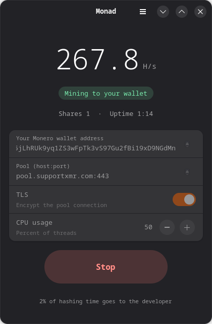

# Monad

A minimalist Monero miner for Linux. Paste your wallet, press **Start**.



- GTK4 / libadwaita interface: hashrate, status, shares, uptime. That's all.
- XMRig RandomX engine, CPU only. Works with any Stratum pool, TLS on by default.
- Checks Monero addresses (base58 + Keccak checksum) before you mine.
- Adjustable CPU usage. Runs at low priority (`nice 10`) so the desktop stays responsive.
- Only mines while the window is open and you have pressed Start. No autostart, no tray, no background mode.

## Developer fee: 2%

Monad is free software funded by a **2% developer fee on hashing time**.

- About one minute in every fifty, Monad switches XMRig to mine to the
  developer's wallet on `pool.supportxmr.com:443` (TLS), then switches back.
  The pool connection is hot-swapped, so RandomX is not re-initialised.
- The status line shows **"Developer fee · m:ss left"** while it runs.
- Time is only counted while actually hashing, never during RandomX setup
  or reconnects. A fee-time ledger is kept in
  `~/.local/state/monad/fee-ledger.json`, so short sessions add up fairly and
  a stopped slice only counts the time it actually mined.
- XMRig's own built-in 1% donation is **disabled**
  (`patches/xmrig-disable-donation.patch`), so the total is 2%, not 3%.
- It is 2% of *hashing time*. Pool payout thresholds and share luck mean it
  is not exactly 2% of coins.
- The fee is explained, and must be accepted, before the first start.

Developer wallet (also in `monad/constants.py`):

```
49PHjHqpnRSdZxFgaEyhyzVBbiD8nbV3XVBdEequwaisidKejyZ8wti5jLhRUk9yq1ZS3wFpTk3vS97Gu2fBi19xD9NGdMn
```

## Install

| Channel | How |
|---|---|
| Flathub / Bazaar / GNOME Software / Discover | `flatpak install flathub io.github.numbpill3d.Monad` *(after acceptance)* |
| AUR | `yay -S monad` *(after upload)* |
| From source | see below |

### From source

Runtime dependencies: Python ≥ 3.10, PyGObject, GTK ≥ 4.12, libadwaita ≥ 1.5.
Build dependencies for XMRig: cmake, libuv, hwloc, openssl.

```sh
curl -LO https://github.com/xmrig/xmrig/archive/refs/tags/v6.26.0.tar.gz
tar xf v6.26.0.tar.gz && cd xmrig-6.26.0
patch -p1 < ../patches/xmrig-disable-donation.patch
patch -p1 < ../patches/xmrig-openssl4.patch
cmake -B build -DWITH_OPENCL=OFF -DWITH_CUDA=OFF && cmake --build build -j
sudo install -Dm755 build/xmrig /usr/lib/monad/xmrig
cd .. && sudo make install PREFIX=/usr
```

Run straight from the checkout with `MONAD_XMRIG=/path/to/xmrig ./bin/monad`.

## Development

```sh
make test     # fee scheduler + address validation unit tests
make check    # tests + desktop-file-validate + appstreamcli validate
```

## Packaging

- `packaging/flatpak/io.github.numbpill3d.Monad.yml`: local manifest that builds from this tree.
  `flatpak run org.flatpak.Builder --user --install --force-clean build-dir packaging/flatpak/io.github.numbpill3d.Monad.yml`
- `packaging/flatpak/flathub/`: the files for the Flathub submission PR (git source pinned to the release tag).
- `packaging/aur/`: `PKGBUILD` + `.SRCINFO` for the AUR.

See `packaging/SUBMITTING.md` for the release checklist.

## Notes

- Mining makes your CPU run hot and uses electricity. Only mine on hardware you own or have permission to use.
- In the Flatpak sandbox, MSR tweaks and 1 GB pages are off (they need root).
  2 MB huge pages are used if the system provides them
  (`sudo sysctl vm.nr_hugepages=1280`).

## License

GPL-3.0-or-later. Mining engine: [XMRig](https://github.com/xmrig/xmrig) (GPL-3.0).
